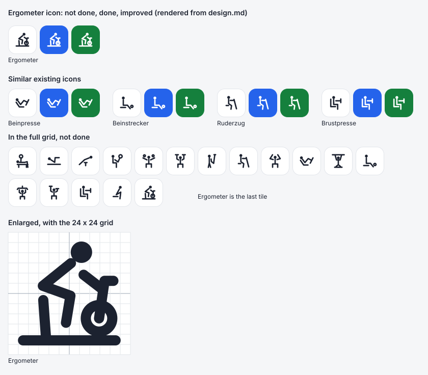

# Design

## Context

The motivation is in proposal.md, and the behaviour is in the three spec deltas.

How the code treats an exercise today:
- **Header.** `parseHeader` in `sheet-format.js` turns row 1 into `{ name, weightCol, repsCol }` pairs. Nothing tells one exercise kind from another, except the "(assistiert)" marker, which only changes the "improved" comparison.
- **Workout.** `buildToday`, `initialState`, `cellsFor` and `progressOf` in `workout.js` all assume a weight cell and a reps cell. An Ergometer time such as "3:30" is an unreadable reps entry. The editor therefore opens in text mode, `last` is never set, and the tile can be done but never improved.
- **History.** `historyOf` in `stats.js` counts the same row as a session that is never readable. Ergometer is then left out of every average and the graph.
- **Already right.** `withToday` (today's values for History) and `writeCells` work with any two cells. They need no change.

Two other changes are open on `main`, and both only wait for a manual check by the user:
- `add-history-analysis` creates the `workout-history` capability that this change modifies. It has to be archived first (see "Migration Plan").
- `last-time-link-confetti` only adds requirements to `todays-workout`, none of which this change modifies. Its confetti and vibration fire on any tile turning green, so Ergometer gets both with no extra code.

The page has no build step and loads nothing from third parties except Google's sign-in script. The pure modules are tested with Node's built-in runner.

## Goals / Non-Goals

**Goals:**
- One function decides whether an exercise is timed, and every module asks it.
- The new rules are pure functions in `sheet-format.js`, `workout.js` and `stats.js`, each covered by Node tests like the existing rules.
- The weight-and-sets exercises keep their behaviour, and their existing tests pass unchanged.

**Non-Goals:**
- A general framework of exercise kinds. There is one timed exercise, and the code branches on one flag.
- Renaming `weightCol` and `repsCol` everywhere.
- Reading time displays other than `m:ss`, such as a three-part `h:mm:ss`.

## Decisions

### `sheet-format.js` decides what a column pair means, by name
`sheet-format.js` gets a list of timed exercise names, `['Ergometer']`, and `isTimed(name)`:
- The lookup normalises both sides with `normalize('NFC')` and `toLowerCase()`, as `iconFor` does.
- It compares the whole trimmed name. Unlike the icon lookup, it does not strip an "(assistiert)" marker, which means nothing for an ergometer.

`parseHeader` adds `timed` to each entry. `workout.js` and `stats.js` both build their exercises from `parseHeader`, so they agree by construction.

- *Alternative: a marker in the header, like "(Zeit)".* Rejected, because the user already named the column "Ergometer" in both sheets, and a marker is one more thing to type exactly.
- *Alternative: detect the kind from the cells, such as a column of `m:ss` values.* Rejected. An empty column or one typo would switch the editor between kinds.
- *Alternative: keep the list in `icons.js`.* Rejected, because icons are about the picture, while the kind decides how cells are read and written.

**Column names stay.** For a timed exercise, `weightCol` holds the intensity and `repsCol` the time. Renaming them would touch every module, every test and the `withToday` entries, with no change in behaviour. The comment on `parseHeader` says what the two columns hold for each kind.

### Notation: `parseIntensity`, `parseTime` and `formatTime`
All three are added to `sheet-format.js`, next to `parseWeight` and `parseReps`, with the same result shapes:
- **`parseIntensity(text)`** returns `{ value, unreadable }`. It matches `^\d+$` after trimming, and an empty cell gives `{ value: null, unreadable: false }`.
- **`parseTime(text)`** returns `{ seconds, unreadable }`. It matches `^(\d+):([0-5]\d)$` after trimming, and an empty cell gives `{ seconds: null, unreadable: false }`.
  - The user's hand-typed Ergometer cells display as "03:30". Google Sheets stored the typed "3:30" as a time of day, 3 hours 30 minutes, and displays it as `hh:mm`. Read as displayed, the first part is the user's minutes, so the leading zero is all the pattern has to allow.
  - A three-part display such as "1:03:30" is unreadable rather than read as hours. The app never writes three parts.
- **`formatTime(seconds)`** returns minutes without a leading zero, a colon and two digits of seconds: 210 gives "3:30", 45 gives "0:45" and 4500 gives "75:00".

The app writes the intensity with `String(value)`, which needs no helper of its own.

### `buildToday`: one entry shape per kind
The exercises from `buildToday` get `timed`. Three helpers branch on it, and the rest of `buildToday` stays as it is:
- **`read(row, exercise)`**:
  - For a timed exercise, it returns `{ row, weightText, repsText, intensity, time }`, with `intensity` from `parseIntensity` and `time` from `parseTime`.
  - For any other exercise, it returns the existing `{ row, weightText, repsText, weight, reps }`.
  - Keeping `weightText` and `repsText` lets `today.js` and `withToday` handle both kinds the same way.
- **`hasEntry(row, exercise)`**, which feeds "done in the last workout": a timed exercise needs a non-empty time cell after trimming. Every other exercise keeps `parseReps(...).sets.length > 0`.
- **`hasReadable(entry, exercise)`**, which feeds "last time": a timed exercise needs `time.seconds !== null && !time.unreadable`. Every other exercise keeps "some set is not null".

`parseReps("3:30")` happens to give one unreadable entry, so the old `hasEntry` would already count a time. The explicit branch keeps the rule readable and independent of that accident.

### Editor state: a third mode, `'timed'`
**`initialState`**, for a timed exercise:
- It returns `{ mode: 'text', … }` when today's intensity or time is unreadable. This is the same text mode as before, so writes keep the text exactly as entered.
- Otherwise it returns `{ mode: 'timed', intensity, time, placeholder }`:
  - `intensity` is today's intensity, or else last time's;
  - `time` is today's time, formatted;
  - `placeholder` is last time's time, formatted.

**`cellsFor`**, in timed mode:
- It checks the intensity against `WHOLE_PATTERN` and the time with `formatTimeInput`, and returns `invalid = { intensity, time }` when either fails.
- Without a time, it returns both cells empty.
- Otherwise it returns `weightText`, the intensity or `''`, and `repsText`, `formatTime(seconds)`.

`writesFor` and `removeSet` need no change.

**`formatTimeInput(text)`** is added to `workout.js`. It reads what the user types, not what the sheet holds, so it lives next to the other input rules. It returns `{ text, seconds, invalid }`, where `text` is what the field shows:
1. It keeps only the digits and drops leading zeros. Nothing left gives `{ text: '', seconds: null, invalid: false }`.
2. It pads the digits to at least three with zeros in front. The last two are the seconds, and the rest are the minutes as a number, so `text` is minutes, a colon and the two digits: "4" gives "0:04", "415" gives "4:15", and "0330" gives "3:30".
3. Seconds above 59 give `invalid: true` and `seconds: null`, but `text` still shows them ("390" gives "3:90"), so the user can see and correct them.

The function is idempotent: a formatted text such as "3:30" gives itself back. That is what keeps an unchanged field valid, and what makes deleting work. "4:15" with its last digit deleted is "4:1", which gives "0:41". Dropping leading zeros is what lets repeated deletions empty the field: "0:0" gives nothing, not "0:00".

- *Alternative: let `parseTime` accept bare digits as well.* Rejected. In a sheet cell, "330" is a typo to show as text, not a time to guess. Two functions keep the strict notation and the lenient input apart.

### The time field: numeric keypad, formatted as the user types
`buildExercise` in `today.js` gets a third branch for timed mode:
- **Intensity field:** `inputmode="numeric"`, labelled "Intensity", with no unit. Its accessible name is "Ergometer intensity".
- **Time field:** `inputmode="numeric"`, labelled "Time". Its placeholder is last time's time, and its accessible name is "Ergometer time in minutes and seconds".
- **On every `input` event:** the handler runs `formatTimeInput` on the field's value, writes the result's `text` into the field and into `state.time`, and puts the cursor at the end with `setSelectionRange`. It marks nothing and saves nothing.
- **On `change`:** the handler calls `onChange(item)`, as the other fields do. That is where an invalid time, such as "3:90", is marked, and where a valid one is saved.
- **Text mode** for a timed exercise labels its two fields "Intensity" and "Time" instead of "Weight" and "Reps". Text mode does no formatting, so unreadable cells are still edited exactly as typed.

`markInvalid` marks `input[data-field="intensity"]` and `input[data-field="time"]` from `flags.intensity` and `flags.time`. The existing selectors for the weight and set fields find nothing in a timed editor, so they need no change. Nothing new is needed in `styles.css`, because the two fields use the existing `.exercise label` rules.

**Why the cursor goes to the end.** Digits are entered and deleted at the end, like on a timer. Putting the cursor back at the end after each rewrite keeps both of those working, and it is the only position that stays correct when the colon moves.

- *Alternative: leave the field as typed, and show the formatted time in a readout next to it.* Drawn up first and rejected by the user, who wants the time in the field itself and no extra text.
- *Alternative: two fields for minutes and seconds.* Offered to the user, who chose one field with auto-formatted digits.

### "Improved": a separate `timedProgressOf`
`timedProgressOf({ weightText, repsText }, last)` is added to `workout.js`:
- It returns `'none'` when the time cell is empty after trimming.
- It returns `'done'` without a last time, or when the intensity or the time is unreadable today or last time.
- Otherwise it compares the intensity first, with an empty intensity as 0, and the seconds second. It returns `'improved'` only when today is strictly better.

`today.js` gets one helper, `progressFor(item, cells)`, which picks `timedProgressOf` or `progressOf(cells, last, assisted)`. Both of today's call sites, in `startWorkout` and `onChange`, use it, so the confetti and vibration in `onChange` work for Ergometer unchanged.

- *Alternative: a `timed` parameter on `progressOf`.* Rejected. Its third parameter is already the `assisted` boolean that the tests pass. A fourth boolean makes the calls unreadable, and the two rules share nothing.

### The icon: a rider leaning forward on a stationary bike
`ICONS` gets an `'Ergometer'` entry, drawn by the rules in the design of the archived `exercise-icons` change ("Drawing style"). It was drawn in review rounds with the user while planning:
- each round was shown at real size, in the three tile states, in the full grid of 17, and next to Beinpresse, Beinstrecker, Ruderzug and Brustpresse, the other seated pictures;
- the appendix holds the approved data;
- [ergometer-icon.svg](ergometer-icon.svg) in this change is rendered from exactly that data.

The drawing, in side view, faces right like Ruderzug and Brustpresse:
- **Rider:**
  - the head is a dot, ahead of the hip, so the rider leans forward;
  - torso, thigh and shin are one stroke, as in Beinstrecker, and the shin ends at the pedal;
  - the arm is a separate stroke with a gap to the torso, and the hand touches the handlebar post.
- **Machine**, one connected shape:
  - the post rises from the flywheel's hub to a short handlebar pointing forward;
  - the flywheel is a ring of radius 2.6, resting on the base. A flywheel is a weighted disc, which is what a ring stands for in the rules;
  - the seat post stands on the base and ends 0.6 units of white below the rider's thigh. As in Beinstrecker and Brustpresse, whose seats also sit below the rider, the gap lets the rider read apart from the machine. The rules only require hands to touch what they grip, and here they do.

It is balanced like the others: the larger side of its ink box, strokes included, is 20.4 units, the median of the 16 existing icons, and the box is centred on (12, 12).

Alternatives, each drawn and rendered at real size:
- *An upright rider with a slight lean, with or without a handlebar stub and with a larger flywheel.* Not chosen. The upright pose reads less as pedalling at 32px, and without the stub the post reads as a plain stick.
- *The same drawing with the seat post touching the hip.* Approved first, then replaced at the user's request by the gap at the seat.
- *A gap at the hands as well, with the post and flywheel moved forward.* Not chosen. It breaks the rule that hands touch what they grip, and the arm becomes short.
- *First sketches with the flywheel beside the front post, or a small crank ring under the foot.* Rejected. The seat post, the shin and the front post ran close and parallel, and the ring against the post formed letter-like shapes such as "b" and "6".

### History: `timed` sessions, averages and a time graph
In `stats.js`:
- **`historyOf`:**
  - Each exercise gets `timed`.
  - A timed exercise's row is a session when its time cell is non-empty after trimming.
  - A timed session is `{ date, day, intensity, time, readable }`, where `readable` means that neither cell is unreadable.
  - A timed exercise's `baseline` is `null`, because only the biggest gain uses the baseline, and timed exercises never count for it.
- **`yearSoFar`:** sets and reps skip timed exercises, and so does the gain loop, next to the assisted check. `mostDone` counts every exercise's sessions, so Ergometer can be the most-done exercise.
- **`summaryOf`:**
  - For a timed exercise, it returns `averageIntensity` and `averageTime`, with `averageReps` and `averageWeight` set to `null`.
  - `averageIntensity` is the mean over the readable sessions that have an intensity, rounded to one decimal.
  - `averageTime` is `Math.round` of the mean of the seconds.
  - Each point's value is the session's seconds.
  - Every other exercise gets `null` for the two new fields, so `history.js` can tell which averages to show.

In `history.js`:
- **`buildResults`** shows "Intensity per session" with no unit, and "Time per session" with `formatTime`. The graph's caption is "Time per session".
- **`buildGraph`** takes a measure, `{ name, format, unit }`, instead of the `assisted` flag:
  - `format` writes the axis labels;
  - `name`, `format` and `unit` together write the accessible name.

  The three measures are:
  - estimated 1RM: `formatWeight`, unit " kg";
  - assistance: `formatWeight`, unit " kg";
  - time: `formatTime`, no unit.

  The scale code is unchanged: seconds plot like kilograms.

## Risks / Trade-offs

- **[Hand-typed times of 24 minutes or more]** Google Sheets stores a hand-typed time as a time of day and displays it as `hh:mm`, so a typed "45:00" (45 hours) displays as "21:00". The app reads the display, so it reads 21 minutes, and it cannot tell.
  - Cells the app writes are text and are not affected.
  - Mitigation: the README says to log Ergometer with the app, or to type a time by hand with a leading apostrophe ('45:00), which keeps it as text.
  - Task 1.2 checks the development sheet's existing Ergometer cells for times of 24 minutes or more.
- **[Hand-typed times in another form]** Another locale, or a column with another format, may display a hand-typed time in a form the notation does not read, such as "3:30:00 AM".
  - Mitigation: such a cell is unreadable. Today's cell then opens as text, and an earlier cell is skipped for "last time", so no data is lost or overwritten.
- **[Bare digits are seconds]** Typing "5" gives 0:05, not 5:00. Mitigation:
  - the field shows "0:05" as soon as the digit is typed;
  - the placeholder shows last time's time in `m:ss`, which shows the scale.
- **[The cursor jumps to the end]** A digit typed or deleted in the middle of the field is applied, but the cursor then moves to the end. Deleting the colon changes nothing, because the field formats itself again.
  - Mitigation: entering and deleting at the end, the normal way on a phone, behaves like a timer. Selecting all and typing replaces the time.
- **[A lone zero shows nothing]** Typing "0" into an empty field leaves it empty, because leading zeros are dropped.
  - This is needed so that deleting can empty the field. A time never starts with a meaningful zero.
- **[A renamed header column]** A column renamed away from "Ergometer" loses the timed parsing and its icon. Its times then read as unreadable reps, so the editor shows text fields and the tile shows letters.
  - Mitigation: this is visible at once, and the README names the exact header.
- **[`weightCol` and `repsCol` hold other things for a timed exercise]** A future reader may assume weight and reps.
  - Mitigation: the comment on `parseHeader`, and tests that build Ergometer rows through these columns.
- **[Intensity alone decides first]** Raising the intensity while cutting the time short turns the tile green. This is the rule the user chose, by analogy with "heaviest weight first".
- **[Similar icons]** Ergometer and Beinstrecker are both seated figures whose torso, thigh and shin are one stroke.
  - Mitigation: Ergometer's rider leans forward, and its flywheel, handlebar post and base have no counterpart in Beinstrecker.
  - Both were checked side by side and in the full grid at real size. The editor heading and the tooltip still name the exercise.

## Migration Plan

There is no data migration. The app writes Ergometer cells only when the user logs Ergometer, and existing cells stay as they are.

- **Branch.** The worktree branch `worktree-add-ergometer-exercise` starts at `main`'s head (`cc1793b`).
- **Archive order.** Archive `add-history-analysis` before this change. Archiving applies this change's MODIFIED requirements of `workout-history`, which need that capability's main spec to exist.
- **Ship and roll back.** The change ships with the next GitHub Pages deploy of `main`. To roll back, revert the merge commit.
  - After a rollback, Ergometer cells written as "8" and "3:30" read as unreadable reps again. They show in text mode, and nothing is lost.

## Appendix: Ergometer icon data

The approved, balanced drawing, as it goes into `ICONS`. [ergometer-icon.svg](ergometer-icon.svg) is rendered from exactly this data.



```js
  'Ergometer': {
    d: 'M12.32 6.06L6.81 10.5L12.22 12.44L11.35 17.74 M14.81 8.33L18.6 11.25 M17.84 16.88L18.92 9.52L20.65 9.52 M6.89 13.3L7.46 21.2 M2.92 21.2L21.08 21.2',
    dots: [[14.38, 3.9, 2.1]],
    rings: [[17.84, 16.88, 2.6]],
  },
```
