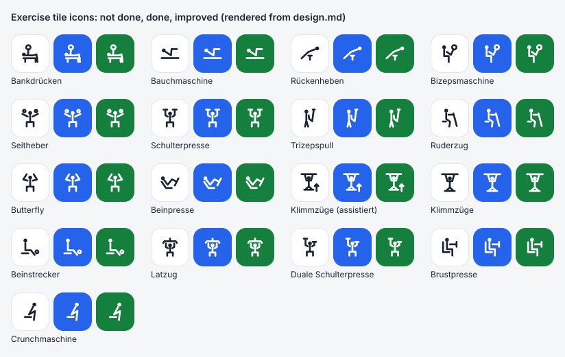

# Spec Delta

The approved drawings are shown in [icons.svg](../../icons.svg), rendered from the icon data in design.md.

## ADDED Requirements

### Requirement: Sixteen exercises have an icon
The exercises with the German names Bankdrücken, Bauchmaschine, Rückenheben, Bizepsmaschine, Seitheber, Schulterpresse, Trizepspull, Ruderzug, Butterfly, Beinpresse, Klimmzüge, Beinstrecker, Latzug, Duale Schulterpresse, Brustpresse and Crunchmaschine SHALL each have an icon of their own. A header name SHALL get an icon when it equals one of these German names, ignoring upper and lower case and an "(assistiert)" marker. Every other exercise SHALL have no icon.

#### Scenario: Exercise with an icon
- **WHEN** the header row names Latzug
- **THEN** Latzug's tile shows its icon and no letters

#### Scenario: Different case
- **WHEN** the header row names "LATZUG"
- **THEN** its tile shows Latzug's icon

#### Scenario: Assisted exercise
- **WHEN** the header row names "Latzug (assistiert)"
- **THEN** its tile shows Latzug's icon

#### Scenario: Different spelling
- **WHEN** the header row names "Klimmzug"
- **THEN** its tile shows no icon and the label "Kl"

#### Scenario: Every icon is different
- **WHEN** the header row names all sixteen exercises
- **THEN** no two of their tiles show the same icon

### Requirement: Assisted Klimmzüge show the assistance
When Klimmzüge is marked "(assistiert)", its icon SHALL show an upward arrow for the assistance. Without the marker, Klimmzüge SHALL show the same figure without the arrow. No other exercise SHALL show an assistance arrow, with or without the marker.

#### Scenario: Assisted Klimmzüge
- **WHEN** the header row names "Klimmzüge (assistiert)"
- **THEN** its tile shows the pull-up figure with an upward arrow

#### Scenario: Marker in another case
- **WHEN** the header row names "Klimmzüge (Assistiert)"
- **THEN** its tile shows the pull-up figure with an upward arrow

#### Scenario: Klimmzüge without assistance
- **WHEN** the header row names "Klimmzüge"
- **THEN** its tile shows the same pull-up figure without the arrow

## MODIFIED Requirements

### Requirement: Exercises are shown as tiles
The workout screen SHALL show one tile for every exercise of the header row, in the order of the header row, above the exercise editor. Each tile SHALL show the exercise's icon if it has one, and its label otherwise. An icon SHALL stay visible in each of the tile's state colours. Each tile SHALL have the exercise's full name and its state today as its accessible name.

#### Scenario: Tiles for every exercise
- **WHEN** the header row names Bankdrücken, Latzug and Beinpresse, and only Latzug has values today
- **THEN** the workout screen shows three tiles, for Bankdrücken, Latzug and Beinpresse, in that order

#### Scenario: Icon or label
- **WHEN** the header row names Latzug, then Kniebeuge
- **THEN** Latzug's tile shows its icon and Kniebeuge's tile shows "Kn"

#### Scenario: Icon on a coloured tile
- **WHEN** Latzug is done today
- **THEN** its tile shows the "done" colour, and its icon is drawn in the tile's text colour for that state

#### Scenario: Accessible name
- **WHEN** a screen reader reaches the tile of Latzug, which is done today
- **THEN** it announces the full name "Latzug" and that it is done today

### Requirement: Tile labels are unique
A tile without an icon SHALL show a label: the first letter of the exercise's name followed by its second letter, the first in upper case and the second in lower case. Only letters SHALL count. If an earlier tile already shows that label, ignoring case, the second letter SHALL be the next letter of the name that gives an unused label. If no letter does, the label SHALL stay the first two letters. Tiles with an icon SHALL NOT take a label.

#### Scenario: Plain label
- **WHEN** the header row names Kniebeuge
- **THEN** its tile shows "Kn"

#### Scenario: Name with several words
- **WHEN** the header row names Schräges Bankdrücken
- **THEN** its tile shows "Sc"

#### Scenario: Two names with the same first letters
- **WHEN** the header row names Wadenheben, then Wadenpresse
- **THEN** Wadenheben's tile shows "Wa" and Wadenpresse's tile shows "Wd"

#### Scenario: Repeated letters are skipped
- **WHEN** the header row names Wadenheben, Wadenpresse, then Wadenstrecker
- **THEN** Wadenstrecker's tile skips "Wa" and "Wd", both taken, and shows "We"

#### Scenario: Icon tiles do not take labels
- **WHEN** the header row names Bankdrücken, Bauchmaschine, then Bauchpresse
- **THEN** Bankdrücken and Bauchmaschine show their icons, and Bauchpresse's tile shows "Ba"
